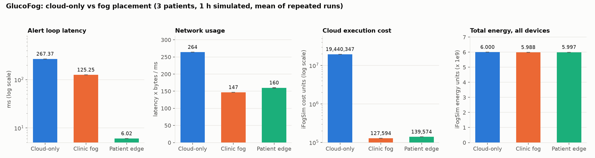
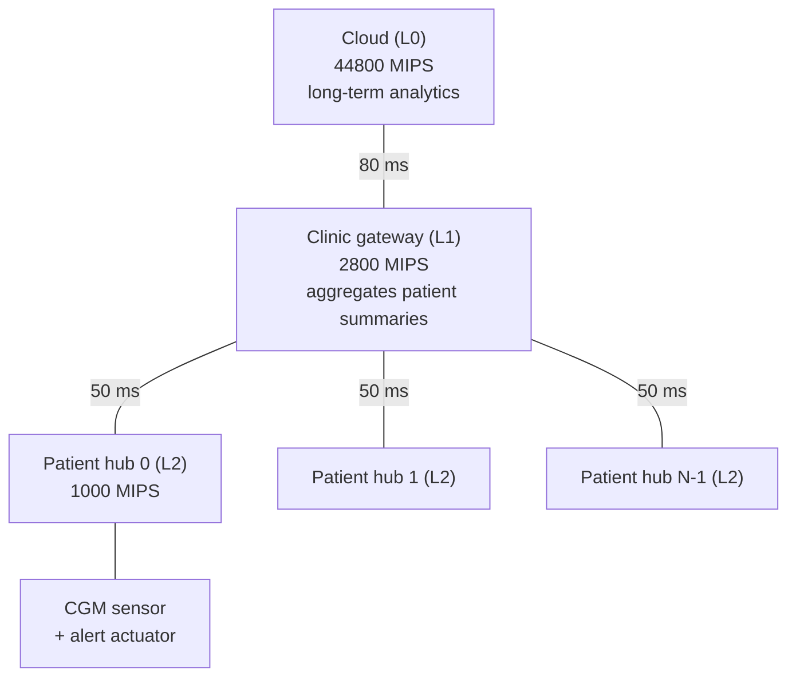
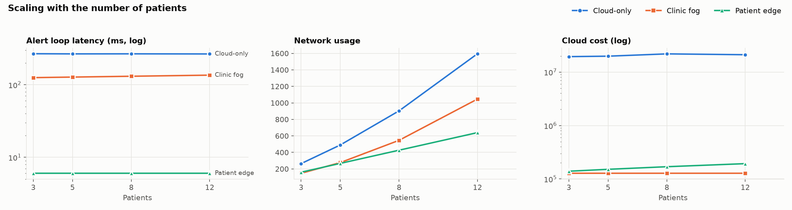
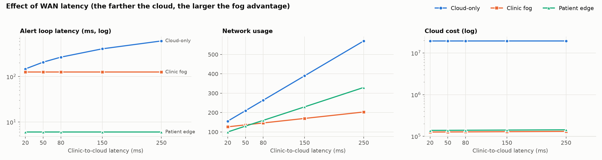
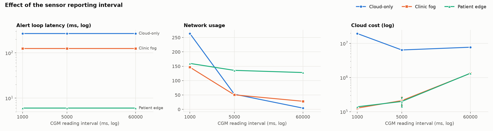
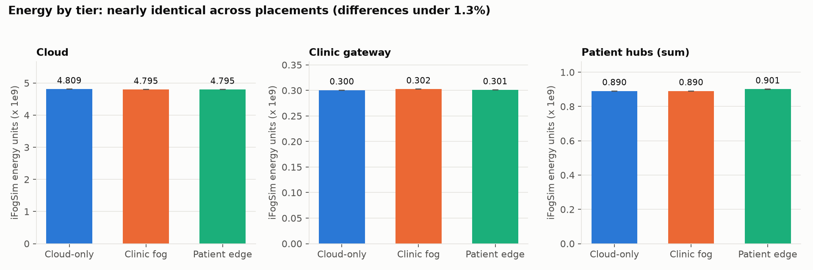

# GlucoFog

**Fog-assisted hypoglycemia / hyperglycemia alerts for continuous glucose monitoring, simulated in iFogSim2.**

Running glucose-threshold detection on a fog node next to the patient makes the alert loop **44× faster** than a cloud-only design (6.0 ms vs 267.4 ms), cuts cloud compute cost by **99%**, and reduces network usage by about **40%**. Energy is essentially unchanged. The advantage also grows with WAN latency and holds as the patient count scales.



## The question

A cloud-only alert system sends every glucose reading over the internet, decides in the cloud, and sends the alert back. The most urgent decision (is this patient in danger right now?) then depends on the slowest, least reliable link. GlucoFog asks:

> Does detecting at the fog edge reduce alert latency and upstream traffic without an unacceptable energy or cost penalty, and *where* in the fog should detection run?

## Architecture



Application pipeline:

```
CGM_READING -> reading_filter -> hypo_hyper_detector -> ALERT        (critical loop)
                                        |
                                        +-> clinic_aggregator -> cloud_analytics   (periodic summaries)
```

Three placements are compared on the same topology and workload; only where the detection modules run changes:

| Mode | `reading_filter` + `hypo_hyper_detector` run on |
|---|---|
| `cloud` | Cloud (baseline) |
| `clinic` | Clinic gateway (one hop from the patient) |
| `edge` | Each patient's own hub |

## Results

Three patients, one hour of simulated time, one reading per second per patient, 80 ms clinic-to-cloud link. Each cell is the mean of 10 runs (iFogSim's tuple selectivity is random). Raw data is in [`results/metrics.csv`](results/metrics.csv) and [`results/summary.csv`](results/summary.csv).

| Metric | Cloud-only | Clinic fog | Patient edge |
|---|---|---|---|
| Alert loop latency (ms) | 267.4 | 125.3 (−53%) | **6.0 (−97.7%)** |
| Network usage | 263.9 | **146.6 (−44%)** | 159.9 (−39%) |
| Cloud execution cost | 19,440,347 | **127,594 (−99.3%)** | 139,574 (−99.3%) |
| Total energy (×10⁹) | 6.000 | 5.988 (−0.2%) | 5.997 (−0.04%) |

- **Latency:** at the edge the alert never leaves the patient's home network. Clinic fog still pays the 50 ms home link in each direction.
- **WAN sweep (20 to 250 ms):** cloud-only latency rises from 147 ms to 607 ms; fog latency does not move at all. At 250 ms the cloud design uses 570 units of network vs 330 (edge) and 203 (clinic).
- **Scaling (3 to 12 patients):** at 12 patients cloud-only network usage is 1596 vs 640 (edge) and 1046 (clinic); edge latency stays at 6.0 ms.
- **Energy:** nearly identical across placements, because iFogSim's power model is dominated by idle power. Per-tier breakdown: [`figures/fig2_energy_by_tier.png`](figures/fig2_energy_by_tier.png).

| | |
|---|---|
|  |  |
|  |  |

### Limitations worth knowing

- **Sensor interval matters for traffic.** Fog nodes send a summary every 3 s regardless of reading rate. At a 60 s reading interval cloud-only moves *less* data (4.3 vs 28 to 128) because raw forwarding becomes cheap. Latency still favours fog at every interval ([fig 5](figures/fig5_interval.png)).
- **1 reading/s is an accelerated stress setting.** Real CGMs report every 1 to 5 minutes.
- **Units are iFogSim's.** "Network usage" is Σ(link latency × tuple bytes) ÷ simulated time, not bytes. "Cost" and "energy" are model units, not currency or joules.
- **Alerts are broadcast to every hub in iFogSim**, so cloud-mode downlink traffic grows faster than linearly with patient count.
- This is a simulation, not a medical device.

## Run it yourself

Requires `git`, a JDK (tested with JDK 26) and Python 3.

```bash
scripts/setup.sh                      # clones iFogSim at a pinned commit and builds it
scripts/run.sh --mode edge --patients 5 --wan-ms 150   # one simulation
scripts/run_experiments.sh            # full sweep: 300 runs (set REPS=3 for a quick pass)

python3 -m venv .venv && .venv/bin/pip install matplotlib pandas
.venv/bin/python analysis/parse_and_plot.py            # results/*.csv and figures/*.png
```

`run.sh` options: `--mode cloud|clinic|edge`, `--patients N`, `--wan-ms X`, `--home-ms X`, `--interval-ms X`, `--duration-ms X` (default one simulated hour).

## Notes on the simulator

Building this exposed three things in the simulation setup that are worth documenting:

1. **Run length.** iFogSim stops at `Config.MAX_SIMULATION_TIME` (2000 ms by default), which ends the run before each sensor's *second* reading, so a default run compares a single reading per patient. GlucoFog sets it from `--duration-ms`.
2. **Periodic edge arguments.** `Application.addAppEdge` for periodic edges takes `(periodicity, cpuLength, nwLength)`. Passing them in the order `(cpuLength, nwLength, periodicity)` silently makes the summaries 6× more frequent and 3× larger.
3. **A real aggregator.** The clinic aggregator absorbs patient summaries and emits only its own periodic clinic summary. Forwarding one clinic summary per patient summary aggregates nothing and makes fog look worse on network usage than it is.

## Repository layout

```
src/main/java/glucofog/   the simulation (GlucoFogSimulation.java)
scripts/                  setup, single run, full experiment sweep
analysis/                 log parser and chart generation
results/                  raw logs, metrics.csv, summary.csv
figures/                  charts used above
```

## Credits

Built on [iFogSim](https://github.com/Cloudslab/iFogSim) (MIT license), fetched at commit `5f68d39` by `scripts/setup.sh` and not redistributed here.

- H. Gupta, A. V. Dastjerdi, S. K. Ghosh, R. Buyya, "iFogSim: A toolkit for modeling and simulation of resource management techniques in the Internet of Things, Edge and Fog computing environments," *Software: Practice and Experience*, 47(9), 2017. [doi:10.1002/spe.2509](https://doi.org/10.1002/spe.2509)
- R. Mahmud, S. Pallewatta, M. Goudarzi, R. Buyya, "iFogSim2: An extended iFogSim simulator for mobility, clustering, and microservice management in edge and fog computing environments," *Journal of Systems and Software*, 190, 2022. [arXiv:2109.05636](https://arxiv.org/abs/2109.05636)

Licensed under the MIT License (see `LICENSE`).
